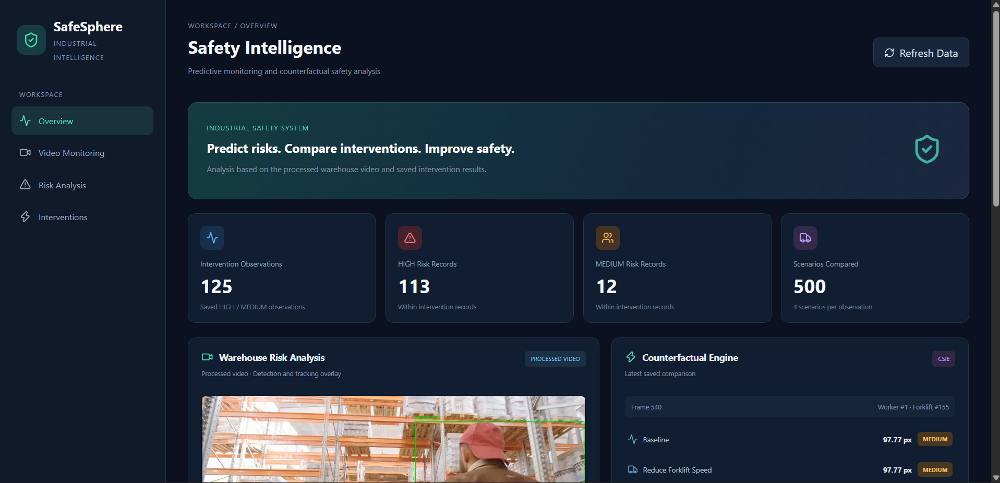

# SafeSphere – Predictive and Counterfactual Industrial Safety Intelligence

SafeSphere is a computer vision-based industrial safety intelligence prototype designed to detect workers and forklifts, track their movement, estimate potential collision risks, and evaluate simulated safety interventions.

Instead of only detecting objects, SafeSphere attempts to understand how workers and industrial vehicles move relative to each other and identify potentially dangerous interactions.

## Dashboard Preview



## Key Features

- **Object Detection:** Detects workers and forklifts from warehouse video footage.
- **Object Tracking:** Tracks detected objects across video frames using ByteTrack.
- **Motion Analysis:** Estimates object movement and velocity using tracked positions.
- **Collision Risk Prediction:** Uses Time-to-Collision (TTC) and Closest Point of Approach (CPA) to estimate potential risks.
- **Risk Classification:** Categorizes observations into HIGH, MEDIUM, and LOW risk levels.
- **Counterfactual Intervention Engine:** Compares simulated safety scenarios to understand how different actions may affect collision risk.
- **Interactive Dashboard:** Displays risk summaries, video analysis, and intervention comparisons.

## Problem Statement

In industrial environments such as warehouses, workers and forklifts often operate in shared spaces. A conventional CCTV system records activities but does not necessarily predict dangerous interactions before they happen.

SafeSphere explores how computer vision and motion analysis can help identify potentially unsafe worker–forklift interactions earlier.

## System Workflow

1. Input warehouse video.
2. Detect workers and forklifts.
3. Track detected objects across frames.
4. Estimate movement and trajectories.
5. Calculate collision-risk indicators.
6. Classify risk levels.
7. Simulate alternative safety interventions.
8. Display results through the dashboard.

## Technology Stack

| Component | Technologies |
|---|---|
| Programming Language | Python |
| Computer Vision | OpenCV |
| Object Detection | YOLO11, YOLO-World |
| Object Tracking | ByteTrack |
| Backend | FastAPI |
| Frontend | React, Vite |
| Database | MongoDB |
| Video Processing | OpenCV, FFmpeg |
| Testing | Pytest |
| Version Control | Git, GitHub |

## Project Structure

```text
SafeSphere/
│
├── backend/
│   ├── api/
│   ├── detection/
│   ├── tracking/
│   ├── prediction/
│   ├── risk_engine/
│   ├── intervention/
│   └── database/
│
├── frontend/
│   └── src/
│
├── datasets/
├── models/
├── videos/
├── tests/
│
├── requirements.txt
├── README.md
└── .gitignore
```

## Risk Prediction Approach

SafeSphere uses motion information from tracked objects to estimate potential collision situations.

### Time-to-Collision (TTC)

TTC estimates how much time may remain before two moving objects reach a potential collision point, based on their relative motion.

### Closest Point of Approach (CPA)

CPA estimates the closest predicted distance between two moving objects during the prediction period.

These indicators are used by the risk engine to classify potential interactions.

## Counterfactual Safety Interventions

SafeSphere evaluates alternative hypothetical scenarios against a baseline scenario.

The implemented scenarios include:

1. **Baseline:** Original estimated movement.
2. **Reduced Forklift Speed:** Simulates reducing forklift velocity.
3. **Worker Pause:** Simulates the worker temporarily stopping.
4. **Alternate Forklift Route:** Simulates changing the forklift's movement direction.

The engine compares the estimated outcomes to help understand how different interventions may change predicted risk.

These are simulations, not commands sent to real industrial vehicles or workers.

## Demo Results

The current warehouse video processing run produced the following observations:

| Metric | Result |
|---|---:|
| Frames Processed | 541 |
| HIGH Risk Observations | 113 |
| MEDIUM Risk Observations | 12 |
| LOW Risk Observations | 336 |
| Intervention Records | 125 |
| Scenario Comparisons | 500 |

Each intervention record is evaluated across four scenarios.

**Note:** These values represent outputs from the current demonstration video and implemented pipeline. They are not actual workplace accident statistics or independently validated safety measurements.

## Installation and Setup

### 1. Clone the Repository

```bash
git clone https://github.com/kasturisinghchauhan/SafeSphere.git
cd SafeSphere
```

### 2. Create a Virtual Environment

```bash
python -m venv .venv
```

Activate it on Windows:

```powershell
.\.venv\Scripts\Activate.ps1
```

### 3. Install Backend Dependencies

```bash
pip install -r requirements.txt
```

### 4. Start the Backend

From the project root directory:

```bash
python -m uvicorn backend.main:app --reload
```

Backend URL:

```text
http://127.0.0.1:8000
```

### 5. Start the Frontend

Open another terminal:

```powershell
cd frontend
npm install
npm run dev
```

Frontend URL:

```text
http://localhost:5173/
```

Open the frontend URL in your browser to access the dashboard.

## API Endpoints

| Endpoint | Description |
|---|---|
| `/` | Backend root endpoint |
| `/health` | Health check |
| `/dashboard/summary` | Dashboard risk summary |
| `/dashboard/interventions` | Intervention records |
| `/dashboard/video` | Processed demonstration video |

The backend also provides interactive API documentation through FastAPI:

```text
http://127.0.0.1:8000/docs
```

## Testing

The project includes automated backend tests using Pytest.

Run the tests from the project root:

```bash
python -m pytest tests -v
```

**Current test result:** 15 tests passed.

## Current Limitations

SafeSphere is an experimental prototype and has several limitations:

- Distances are currently estimated in pixels, not calibrated real-world metres.
- Tracking IDs may occasionally fragment during object occlusion.
- Object detection may produce false positives or miss objects.
- Motion predictions rely on simplified movement assumptions.
- Alternate-route simulations do not yet account for actual warehouse layouts or physical obstacles.
- Risk predictions require further validation using diverse real-world datasets.
- The system is not certified for industrial safety-critical use.

SafeSphere is intended as a research and decision-support prototype. It must not replace physical safety systems, emergency stops, safety-rated sensors, or established workplace safety procedures.

## Future Improvements

- Real-world distance calibration using camera geometry.
- Improved worker and forklift tracking.
- More advanced trajectory prediction.
- Restricted-zone detection.
- Worker posture and activity analysis.
- Context-aware risk prediction.
- Explainable safety alerts.
- Evaluation on diverse real-world industrial datasets.
- Deployment and performance optimization.

## Project Goal

The long-term goal of SafeSphere is to explore how predictive computer vision and counterfactual reasoning can support safer industrial environments by identifying potentially dangerous human–machine interactions before an incident occurs.

---

**Developed as an individual Computer Vision and Machine Learning project.**